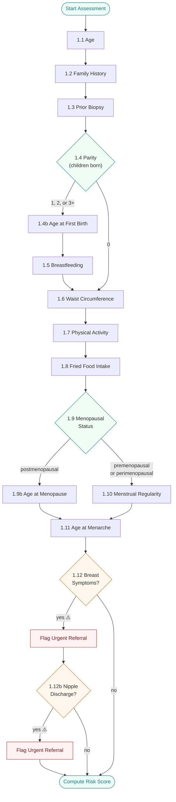

# PinkShieldAI — Questionnaire Flow

This document describes the complete question flow for the breast cancer risk assessment, including branching logic, skip conditions, and safety-critical flags.

Source: `backend/src/engine/factors.py`, `backend/src/engine/state_machine.py`

---

## Question Reference

| # | Factor ID | Label | Question | Type | Options | Skip If | Triggers |
|---|-----------|-------|----------|------|---------|---------|----------|
| 1 | 1.1 | age | How old are you? | integer (18–100) | — | — | — |
| 2 | 1.2 | family_history | Has your mother, sister, or daughter ever been diagnosed with breast cancer? | categorical | yes, no, dont_know | — | — |
| 3 | 1.3 | prior_biopsy | Have you ever had a breast biopsy, or been told you have a breast lump or benign breast condition? | boolean | yes, no | — | — |
| 4 | 1.4 | parity | How many children have you given birth to? | categorical | 0, 1, 2, 3+ | — | 1.4b (if 1, 2, or 3+) |
| 5 | 1.4b | age_first_birth | At what age did you have your first child? | categorical | under_20, 20_24, 25_29, 30_plus | 1.4 = 0 | — |
| 6 | 1.5 | breastfeeding | Did you breastfeed your children? For roughly how long in total across all children? | categorical | never, under_6m, 6_12m, 12_24m, over_24m | 1.4 = 0 | — |
| 7 | 1.6 | waist_circumference | What is your waist measurement in centimetres? | categorical | under_80cm, 80_to_88cm, over_88cm, dont_know | — | — |
| 8 | 1.7 | physical_activity | How would you describe your daily physical activity? Mostly sitting, some walking and housework, or regular exercise or physical labor? | categorical | sedentary, light, moderate, vigorous | — | — |
| 9 | 1.8 | fried_food | How often do you eat fried or deep-fried foods — daily, a few times a week, or rarely? | categorical | daily, few_times_week, once_week, rarely_never | — | — |
| 10 | 1.9 | menopausal_status | Are you still having regular periods? | categorical | premenopausal, perimenopausal, postmenopausal | — | 1.9b (if postmenopausal) |
| 11 | 1.9b | age_at_menopause | At what age did your periods stop? | integer (30–65) | — | 1.9 = premenopausal OR 1.9 = perimenopausal | — |
| 12 | 1.10 | menstrual_regularity | Are your menstrual cycles regular? | boolean | yes, no | 1.9 = postmenopausal | — |
| 13 | 1.11 | age_at_menarche | At what age did you first get your period? | integer (8–20) | — | — | — |
| 14 | 1.12 | breast_symptoms | Have you noticed any changes in your breasts recently — a lump, thickening, pain, or change in shape? | boolean | yes, no | — | 1.12b (if yes) |
| 15 | 1.12b | nipple_discharge | Have you noticed any nipple discharge or skin changes on your breast? | boolean | yes, no | 1.12 = no | — |

---

## Branching Rules

| Parent | Condition | Effect |
|--------|-----------|--------|
| 1.4 (parity) = 1, 2, or 3+ | Child count > 0 | Ask **1.4b** (age at first birth) |
| 1.4 (parity) = 0 | No children | **Skip 1.4b** (age at first birth) |
| 1.4 (parity) = 0 | No children | **Skip 1.5** (breastfeeding) |
| 1.9 (menopausal status) = postmenopausal | Post-menopause | Ask **1.9b** (age at menopause) |
| 1.9 (menopausal status) = premenopausal or perimenopausal | Still menstruating | **Skip 1.9b** (age at menopause) |
| 1.9 (menopausal status) = postmenopausal | Post-menopause | **Skip 1.10** (menstrual regularity) |
| 1.12 (breast symptoms) = yes | Symptoms present | Ask **1.12b** (nipple discharge) + flag **urgent referral** |
| 1.12 (breast symptoms) = no | No symptoms | **Skip 1.12b** (nipple discharge) |

---

## Safety-Critical Questions

| Factor ID | Label | Trigger |
|-----------|-------|---------|
| 1.12 | breast_symptoms | Answer = "yes" flags **urgent clinical referral** |
| 1.12b | nipple_discharge | Answer = "yes" flags **urgent clinical referral** |

When either safety-critical question is answered "yes", the session is marked for urgent referral with a reason string. The assessment continues, but the final result includes a referral flag.

---

## Flowchart

---

## Path Summary

| Path | Questions Asked | Count |
|------|----------------|-------|
| **Maximum** (has children, postmenopausal, breast symptoms + discharge) | 1.1, 1.2, 1.3, 1.4, 1.4b, 1.5, 1.6, 1.7, 1.8, 1.9, 1.9b, 1.11, 1.12, 1.12b | 14 |
| **Minimum** (no children, premenopausal, no symptoms) | 1.1, 1.2, 1.3, 1.4, 1.6, 1.7, 1.8, 1.9, 1.10, 1.11, 1.12 | 11 |
| **Typical** (has children, premenopausal, no symptoms) | 1.1, 1.2, 1.3, 1.4, 1.4b, 1.5, 1.6, 1.7, 1.8, 1.9, 1.10, 1.11, 1.12 | 13 |
